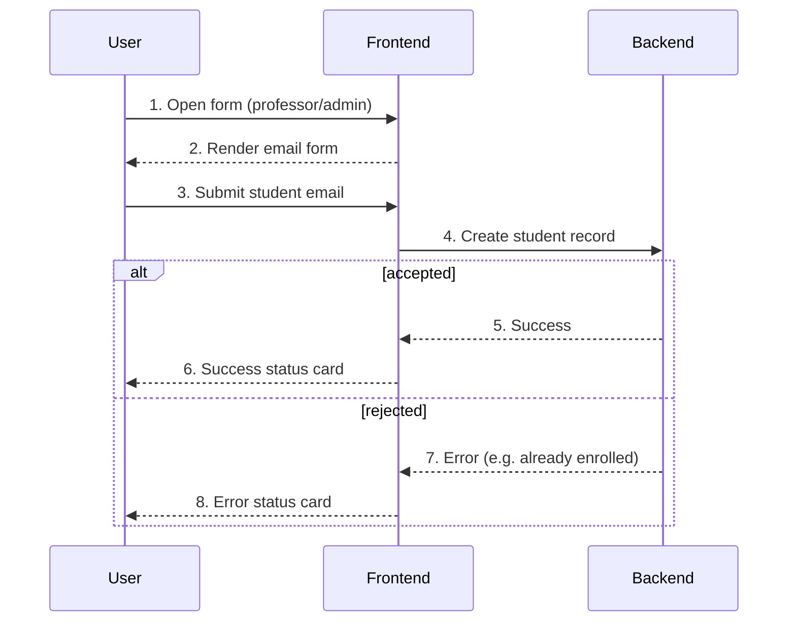

# Add Student — User Flow

## Diagram

## Interaction legend

1. **Open form** — Gated node; only professor/admin reach it, others see NotFound.
2. **Render form** — The email field and Submit button appear.
3. **Submit** — The user enters an email and clicks Submit.
4. **Create record** — The submit handler attempts to enroll the student.
5. **Success** — The handler resolves.
6. **Success card** — The flow transitions to AddStudentStatus in `success`.
7. **Error** — The handler rejects the submission.
8. **Error card** — The flow transitions to AddStudentStatus in `error`.
