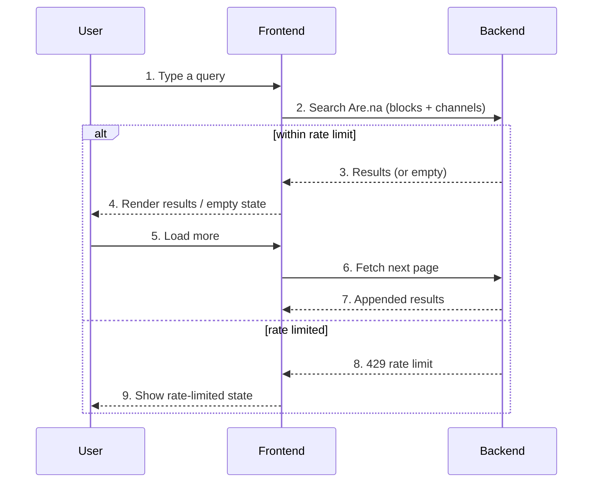

# Arena Search — User Flow

## Diagram

## Interaction legend

1. **Type query** — Debounced input captures the search term.
2. **Search** — `useArenaSearch` requests blocks and channels.
3. **Results** — The API returns matches or an empty set.
4. **Render** — Results list or empty state shows.
5. **Load more** — The user requests the next page of results.
6. **Next page** — The hook fetches the following page.
7. **Append** — New results are appended below existing ones.
8. **Rate limited** — `useRateLimit` detects a 429.
9. **Rate-limited state** — A cooldown message replaces results.

## Third-party notes

- **Are.na API**: Receives the query and pagination cursor; returns matching blocks and channels (titles, thumbnails, ids).
