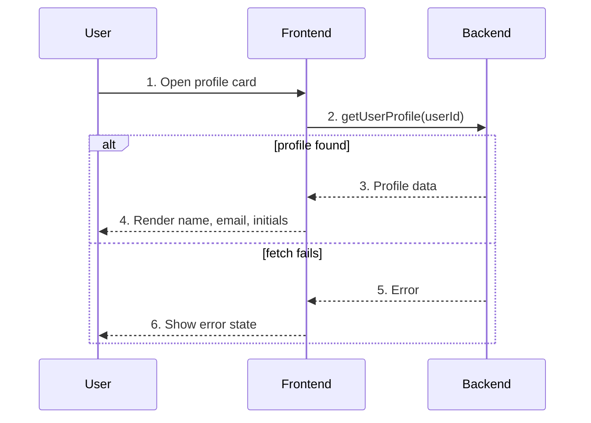

# Example Card — User Flow

## Diagram

## Interaction legend

1. **Open card** — The card mounts and triggers its fetch; the skeleton shows.
2. **Fetch profile** — `getUserProfile` is called with the target user id.
3. **Profile data** — The action resolves with name, email, and avatar info.
4. **Render** — The success card displays the profile and initials avatar.
5. **Error** — The action rejects or returns no profile.
6. **Error state** — The card swaps to an inline error message.
