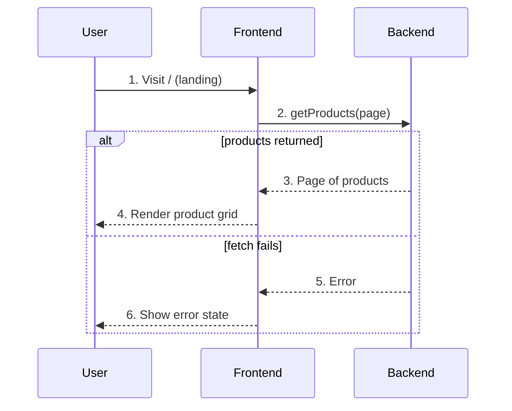

# Home — User Flow

## Diagram

## Interaction legend

1. **Visit landing** — The user opens `/`; the home page mounts.
2. **Fetch page** — `getProducts` is called for the current page (six per page).
3. **Page data** — The action resolves with the page's products.
4. **Render grid** — Products fill the card grid layout.
5. **Error** — The action rejects.
6. **Error state** — The page swaps to an inline error message.
