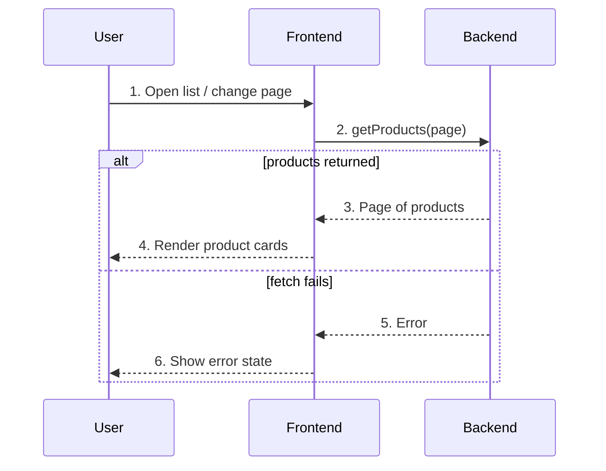

# Product List — User Flow

## Diagram

## Interaction legend

1. **Open / paginate** — Mounting or clicking prev/next requests a page.
2. **Fetch page** — `getProducts` is called with the requested page number.
3. **Page data** — The action resolves with up to three products.
4. **Render cards** — Each product renders as a card with name and price.
5. **Error** — The action rejects.
6. **Error state** — The list swaps to an inline error message.
