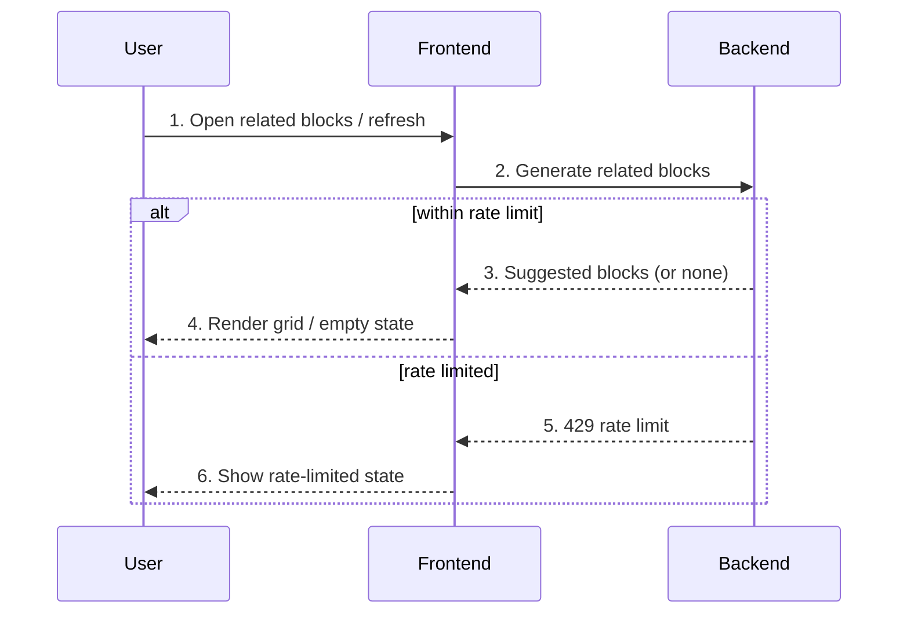

# Related Blocks — User Flow

## Diagram

## Interaction legend

1. **Open / refresh** — Mounting or clicking refresh requests suggestions.
2. **Generate** — `useRelatedBlocks` asks the AI service for related blocks.
3. **Suggestions** — The service returns suggested blocks or an empty set.
4. **Render** — The block grid or empty state shows.
5. **Rate limited** — The service signals a 429.
6. **Rate-limited state** — A cooldown message replaces the grid.

## Third-party notes

- **AI suggestion service**: Receives the source block id; returns a list of related blocks (titles, thumbnails, ids).
